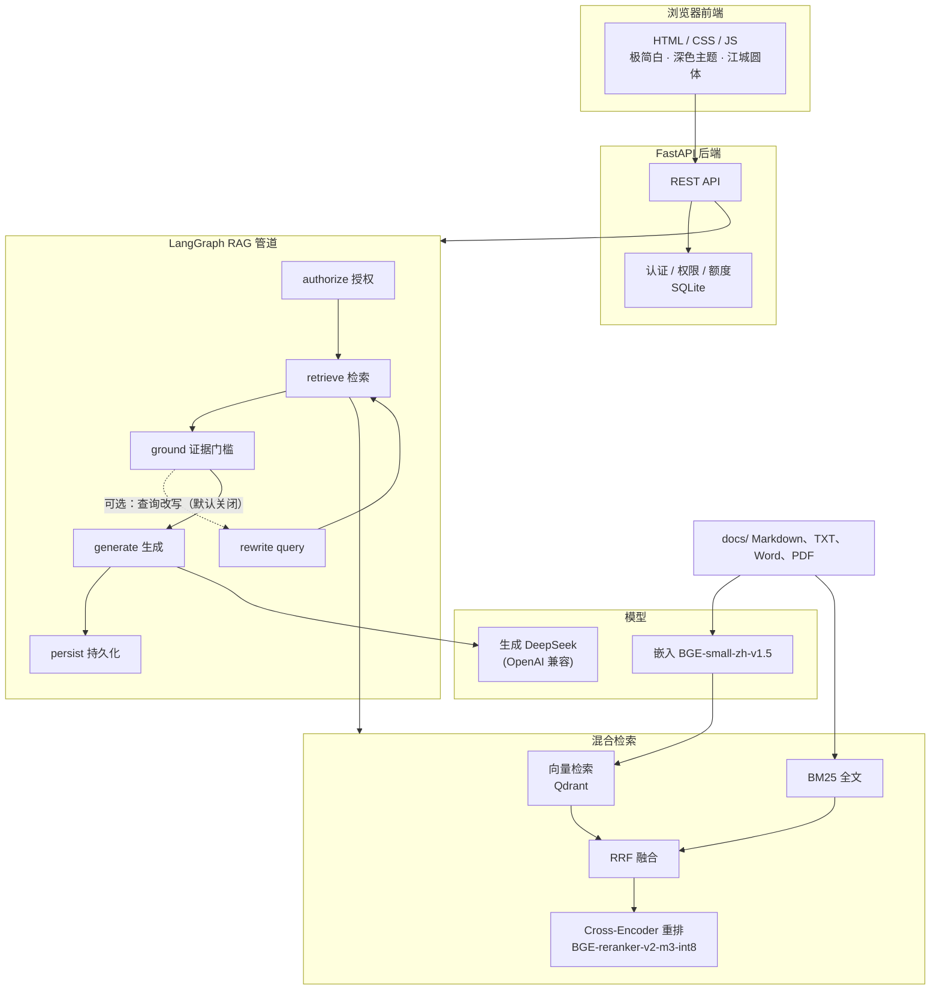

# 智检

一个基于 FastAPI + LangGraph RAG 的本地知识库系统，支持从 Markdown、TXT、Word 和 PDF 中检索并生成带出处的回答。前端为 Vue 3，界面为极简白 + 深色双主题。

## 架构



## 技术栈

| 层 | 技术 |
| --- | --- |
| 后端框架 | FastAPI + Uvicorn |
| RAG 框架 | LangGraph（authorize → hybrid retrieve → ground → generate → persist；可选一次 query rewrite） |
| 提示词编排 | LangChain Core（`ChatPromptTemplate`） |
| 向量数据库 | Qdrant（本地模式） |
| 嵌入模型 | BGE-small-zh-v1.5（fastembed） |
| 重排模型 | BGE-reranker-v2-m3-int8（Cross-Encoder） |
| 大语言模型 | DeepSeek（OpenAI 兼容接口） |
| 前端 | Vue 3（浏览器原生模块，无构建步骤） |

### 检索与反幻觉优化

- **混合检索**：向量 + BM25 → RRF 融合 → Cross-Encoder 重排 top-3
- **证据门槛**：检索分低于阈值的片段直接丢弃，无依据时诚实拒答而非编造
- **强制引用**：生成的每个事实陈述都标注来源编号，可直接跳转到对应段落
- **可选 Agentic RAG**：将 `RAG_QUERY_REWRITE_LIMIT` 设为 `1` 后，检索证据不足时最多改写查询一次并重试；默认值为 `0`，保持当前生产检索行为不变。改写不替代权限与证据规则，也不会扩展授权知识库范围

## 快速开始

### 1. 安装依赖

```powershell
python -m venv .venv
.\.venv\Scripts\Activate.ps1
pip install -r requirements.txt
```

### 2. 配置环境变量

```powershell
Copy-Item .env.example .env
```

在 `.env` 中填写 `DEEPSEEK_API_KEY` 等配置。

### 3. 准备文档并建立索引

将 Markdown、TXT、Word（.docx）或 PDF 放入 `docs/` 后建立索引。在线新建的文档仍是 Markdown。扫描版 PDF 没有文字层，不能被检索。

```powershell
python -m scripts.ingest
```

### 4. 启动服务

双击 `run_server.bat`，或执行：

```powershell
.venv\Scripts\python.exe -m uvicorn app.main:app --host 127.0.0.1 --port 8688
```

浏览器访问 <http://127.0.0.1:8688>。

## 上线注意

- 同一台机器只运行一个服务进程。本地 Qdrant 和 SQLite 不能被第二个进程同时打开。
- 定期复制 `data/knowledge.db`。`data/qdrant/` 可以不备份，文档还在时重新执行 `python -m scripts.ingest` 即可恢复索引。
- 服务放在内网 HTTPS 反向代理后面时，把 `.env` 里的 `SESSION_SECURE` 设为 `1`。本机用 HTTP 调试时保持 `0`。
- `docs/` 下的 Markdown、TXT、Word 和 PDF 都会进入索引。检索时按知识库权限过滤：`AI知识` 归人工智能库，`公司招聘` 归 HR，`游戏开发文档` 归开发库，`股票知识` 和名称未单独映射的测试目录归运营库。`docs/common/` 登录后即可阅读和检索，不必申请权限。

## 项目结构

```text
app/                 FastAPI 后端、认证、SQLite 与 LangGraph RAG 管道
web/                 Vue 前端
scripts/             文档索引脚本
docs/                知识库文档（Markdown、TXT、Word、PDF）
.impeccable.md       设计上下文与设计决策
.env.example         环境变量模板
run_server.bat       一键启动脚本
```

